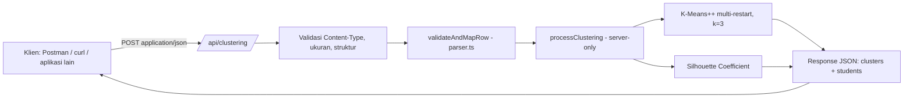

# Laporan Integrasi API — EduCluster AI

| Item | Keterangan |
| :--- | :--- |
| Fitur | **Integrasi API internal (REST API) untuk eksekusi K-Means & Silhouette** |
| Studi kasus | Pemetaan hasil belajar siswa berdasarkan nilai Harian, UTS, dan UAS |
| Repository | https://github.com/Fathor02/Apk-Pemetaan_Siswa |
| Deployment | https://pemetaansiswa-ten.vercel.app |
| Versi API | 1.0.0 |
| Runtime | Node.js (Next.js 15 App Router Route Handler) |

---

## 1. Ringkasan

Fitur ini mengekspos engine klasterisasi yang sudah ada melalui **REST API internal** sehingga konsumen eksternal (Postman, curl, aplikasi lain) dapat mengirim data nilai siswa dan menerima hasil K-Means beserta koefisien Silhouette dalam bentuk JSON.

Integrasi memanfaatkan komponen yang sudah ada, bukan implementasi paralel:

| Komponen | Peran |
| :--- | :--- |
| `src/app/api/clustering/route.ts` | Route Handler (GET + POST), validasi payload, response/error JSON |
| `src/lib/parser.ts` → `validateAndMapRow()` | Validasi rentang nilai 0–100 + hitung ulang Nilai Akhir (0.3/0.3/0.4) |
| `src/lib/clusterEngine.ts` → `processClustering()` | Agregasi per siswa, K-Means k=3, pelabelan, Silhouette |
| `src/lib/kmeans.ts` | K-Means++ multi-restart (`nInit=5`), WCSS, konvergensi Δcentroid < 1e-4 |
| `src/lib/silhouette.ts` | Silhouette Coefficient per siswa dan rata-rata |
| `src/app/api/clustering/sample/route.ts` | Endpointtemplate CSV (sudah ada sebelumnya) |

Seluruh komputasi berjalan di server. Modul `kmeans.ts`, `silhouette.ts`, dan `clusterEngine.ts` menggunakan `import 'server-only'`, sehingga tidak mungkin tereksekusi di browser.

---

## 2. Arsitektur Integrasi



**Karakteristik integrasi:**
- **Stateless** — API tidak menulis ke Supabase maupun cache. Hasil hanya dikembalikan dalam response.
- **Server-side only** — klien tidak pernah menerima kode algoritma, hanya hasil.
- **Deterministik** — urutan label dijamin `Tinggi ≥ Sedang ≥ Rendah` berdasarkan centroid Nilai Akhir berbobot. Catatan: `clusterIndex` adalah indeks internal K-Means++ dan dapat berbeda antar-run bila beberapa partisi memiliki WCSS identik; yang dijamin stabil adalah `clusterLabel` dan nilai centroid.
- **Tanpa auth untuk komputasi** — aman karena tidak ada efek samping. Operasi tulis tetap dilindungi sesi admin HMAC di Server Action (`src/lib/auth.ts`).

---

## 3. Dokumentasi API

### Base URL

| Lingkungan | Base URL |
| :--- | :--- |
| Produksi (Vercel) | `https://pemetaansiswa-ten.vercel.app` |
| Lokal | `http://localhost:3000` |

### Daftar endpoint

| Method | URL | Fungsi | Format response |
| :--- | :--- | :--- | :--- |
| `GET` | `/api/clustering` | Metadata, kontrak, dan batasan API | JSON |
| `POST` | `/api/clustering` | Menjalankan K-Means + Silhouette | JSON |
| `GET` | `/api/clustering/sample` | Mengunduh template nilai siswa | `text/csv` |

> Endpoint `sample` sengaja mengembalikan CSV (bukan JSON) karena memang dipakai sebagai template unggahan.

---

### 3.1 `GET /api/clustering`

**Parameter:** tidak ada.

**Contoh permintaan**
```bash
curl https://pemetaansiswa-ten.vercel.app/api/clustering
```

**Contoh response (200)**
```json
{
  "success": true,
  "meta": {
    "endpoint": "/api/clustering",
    "version": "1.0.0",
    "runtime": "nodejs",
    "documentation": "docs/laporan-integrasi-api.md"
  },
  "data": {
    "name": "EduCluster AI Clustering API",
    "defaults": {
      "mode": "3D",
      "k": 3,
      "nInit": 5,
      "nilaiAkhirWeights": { "harian": 0.3, "uts": 0.3, "uas": 0.4 },
      "labelOrder": ["Tinggi", "Sedang", "Rendah"]
    },
    "limits": {
      "maxBodyBytes": 2097152,
      "maxRecords": 5000,
      "minUniqueStudents": 3
    }
  }
}
```

---

### 3.2 `POST /api/clustering`

**Header wajib:** `Content-Type: application/json`

**Parameter body**

| Field | Tipe | Wajib | Default | Keterangan |
| :--- | :--- | :--- | :--- | :--- |
| `records` | array of object | Ya | — | Baris nilai siswa. Minimal 3 siswa unik. |
| `records[].nis` | string | Ya | — | Nomor induk siswa (unik). |
| `records[].nama_lengkap` | string | Ya | — | Nama siswa. Alias: `nama`. |
| `records[].kelas` | string | Ya | — | Kelas siswa. |
| `records[].kode_mapel` | string | Ya | — | Kode mata pelajaran. |
| `records[].nama_mapel` | string | Ya | — | Nama mata pelajaran. Alias: `mapel`. |
| `records[].nilai_harian` | number | Ya | — | 0–100. Alias: `harian`. |
| `records[].nilai_uts` | number | Ya | — | 0–100. Alias: `uts`. |
| `records[].nilai_uas` | number | Ya | — | 0–100. Alias: `uas`. |
| `records[].semester` | number | Tidak | `1` | Semester analisis. |
| `mode` | string | Tidak | `"3D"` | `"3D"` = [Harian, UTS, UAS]; `"1D"` = [Nilai Akhir]. |
| `periode` | string | Tidak | otomatis | Label periode analisis. |

> `nilai_akhir` **tidak perlu dikirim**. API menghitungnya ulang di server dengan bobot `0.3·Harian + 0.3·UTS + 0.4·UAS` untuk mencegah manipulasi nilai dari klien.

**Contoh request**
```json
{
  "mode": "3D",
  "periode": "Semester Ganjil 2026/2027",
  "records": [
    { "nis": "2026001", "nama_lengkap": "Andi", "kelas": "8A", "kode_mapel": "MTK", "nama_mapel": "Matematika", "nilai_harian": 90, "nilai_uts": 88, "nilai_uas": 92, "semester": 1 },
    { "nis": "2026002", "nama_lengkap": "Budi", "kelas": "8A", "kode_mapel": "MTK", "nama_mapel": "Matematika", "nilai_harian": 70, "nilai_uts": 68, "nilai_uas": 72, "semester": 1 },
    { "nis": "2026003", "nama_lengkap": "Siti", "kelas": "8A", "kode_mapel": "MTK", "nama_mapel": "Matematika", "nilai_harian": 50, "nilai_uts": 55, "nilai_uas": 52, "semester": 1 }
  ]
}
```

**Contoh response sukses (200)** — sebagian field dipangkas untuk keringkasan
```json
{
  "success": true,
  "meta": {
    "endpoint": "/api/clustering",
    "version": "1.0.0",
    "mode": "3D",
    "recordsReceived": 3,
    "processedAt": "2026-11-20T04:12:33.120Z"
  },
  "data": {
    "mode": "3D",
    "k": 3,
    "iterations": 1,
    "converged": true,
    "silhouetteAvg": 1,
    "silhouetteInterpretation": { "status": "Sangat Baik" },
    "clusters": [
      { "index": 0, "label": "Tinggi", "centroid": [90, 88, 92], "count": 1, "percentage": 33 },
      { "index": 1, "label": "Sedang", "centroid": [70, 68, 72], "count": 1, "percentage": 33 },
      { "index": 2, "label": "Rendah", "centroid": [50, 55, 52], "count": 1, "percentage": 33 }
    ],
    "students": [
      { "nis": "2026001", "nama_lengkap": "Andi", "clusterLabel": "Tinggi", "nilai_akhir": 90.2, "s": 1 },
      { "nis": "2026002", "nama_lengkap": "Budi", "clusterLabel": "Sedang", "nilai_akhir": 70.2, "s": 1 },
      { "nis": "2026003", "nama_lengkap": "Siti", "clusterLabel": "Rendah", "nilai_akhir": 52.3, "s": 1 }
    ],
    "totalStudents": 3,
    "periodeAnalisis": "Semester Ganjil 2026/2027"
  }
}
```

**Contoh response gagal (400 — validasi nilai)**
```json
{
  "success": false,
  "error": {
    "code": "VALIDATION_ERROR",
    "message": "1 baris tidak valid. Periksa field yang ditandai.",
    "details": [
      {
        "row": 2,
        "field": "nilai_uas",
        "received": "150",
        "message": "Baris ke-2: Nilai UAS (150) harus berada di antara 0 - 100."
      }
    ]
  }
}
```

### Tabel kode error

| HTTP | `error.code` | Penyebab |
| :--- | :--- | :--- |
| 400 | `INVALID_JSON` | Body bukan JSON / kosong |
| 400 | `INVALID_PAYLOAD` | Body bukan objek atau `records` bukan array |
| 400 | `VALIDATION_ERROR` | Field wajib kosong, nilai di luar 0–100, `mode`/`periode` salah |
| 400 | `INSUFFICIENT_DATA` | Records kosong atau siswa unik < 3 |
| 405 | *(Next.js otomatis)* | Method selain GET/POST |
| 413 | `PAYLOAD_TOO_LARGE` | Body > 2 MB atau records > 5000 |
| 415 | `UNSUPPORTED_MEDIA_TYPE` | `Content-Type` bukan `application/json` |
| 500 | `INTERNAL_ERROR` | Kesalahan internal (detail disembunyikan dari klien) |

---

## 4. Alur Pemrosesan Data

1. Route menerima request dan memeriksa `Content-Type`, ukuran body, serta struktur JSON.
2. Setiap baris divalidasi oleh `validateAndMapRow()` — nama field dinormalisasi, nilai 0–100 dicek, `nilai_akhir` dihitung ulang di server.
3. Jika ada baris invalid → response `400` lengkap dengan nomor baris dan field.
4. `processClustering()` mengagregasi nilai per siswa (bila satu siswa punya beberapa mapel).
5. Vektor fitur dibentuk: `[Harian, UTS, UAS]` untuk mode `3D` atau `[Nilai Akhir]` untuk `1D`.
6. K-Means dijalankan dengan K-Means++ dan `nInit=5`; run dengan WCSS terkecil dipilih.
7. Klaster diurutkan dan diberi label `Tinggi`, `Sedang`, `Rendah` berdasarkan centroid Nilai Akhir berbobot.
8. Silhouette Coefficient dihitung per siswa dan dirata-ratakan.
9. Response JSON disusun dengan header `Cache-Control: no-store` dan `X-Content-Type-Options: nosniff`.

---

## 5. Pengujian

### 5.1 Skenario uji

| # | Skenario | Input kunci | Ekspektasi | Status |
| :--- | :--- | :--- | :--- | :--- |
| 1 | **Sukses** | 3 siswa, nilai valid | `200`, 3 klaster berlabel Tinggi/Sedang/Rendah, `silhouetteAvg` terisi | LULUS |
| 2 | **Gagal — nilai di luar rentang** | `nilai_uas: 150` pada baris 2 | `400 VALIDATION_ERROR`, `details[0].field = "nilai_uas"` | LULUS |
| 3 | **Gagal — data kurang dari 3 siswa** | hanya 2 siswa unik | `400 INSUFFICIENT_DATA`, pesan "kurang dari k=3" | LULUS |
| 4 | **Gagal — Content-Type salah** | header `text/plain` | `415 UNSUPPORTED_MEDIA_TYPE` | LULUS |

### 5.2 Perintah pengujian

**Skenario 1 — sukses**
```bash
curl -i -X POST https://pemetaansiswa-ten.vercel.app/api/clustering \
  -H "Content-Type: application/json" \
  -d '{"records":[{"nis":"2026001","nama_lengkap":"Andi","kelas":"8A","kode_mapel":"MTK","nama_mapel":"Matematika","nilai_harian":90,"nilai_uts":88,"nilai_uas":92},{"nis":"2026002","nama_lengkap":"Budi","kelas":"8A","kode_mapel":"MTK","nama_mapel":"Matematika","nilai_harian":70,"nilai_uts":68,"nilai_uas":72},{"nis":"2026003","nama_lengkap":"Siti","kelas":"8A","kode_mapel":"MTK","nama_mapel":"Matematika","nilai_harian":50,"nilai_uts":55,"nilai_uas":52}]}'
```

**Skenario 2 — nilai 150 (kondisi gagal)**
```bash
curl -i -X POST https://pemetaansiswa-ten.vercel.app/api/clustering \
  -H "Content-Type: application/json" \
  -d '{"records":[{"nis":"2026001","nama_lengkap":"Andi","kelas":"8A","kode_mapel":"MTK","nama_mapel":"Matematika","nilai_harian":90,"nilai_uts":88,"nilai_uas":150},{"nis":"2026002","nama_lengkap":"Budi","kelas":"8A","kode_mapel":"MTK","nama_mapel":"Matematika","nilai_harian":70,"nilai_uts":68,"nilai_uas":72},{"nis":"2026003","nama_lengkap":"Siti","kelas":"8A","kode_mapel":"MTK","nama_mapel":"Matematika","nilai_harian":50,"nilai_uts":55,"nilai_uas":52}]}'
```

**Skenario 3 — hanya 2 siswa (kondisi gagal)**
```bash
curl -i -X POST https://pemetaansiswa-ten.vercel.app/api/clustering \
  -H "Content-Type: application/json" \
  -d '{"records":[{"nis":"2026001","nama_lengkap":"Andi","kelas":"8A","kode_mapel":"MTK","nama_mapel":"Matematika","nilai_harian":90,"nilai_uts":88,"nilai_uas":92},{"nis":"2026002","nama_lengkap":"Budi","kelas":"8A","kode_mapel":"MTK","nama_mapel":"Matematika","nilai_harian":70,"nilai_uts":68,"nilai_uas":72}]}'
```

**Skenario 4 — Content-Type salah (kondisi gagal)**
```bash
curl -i -X POST https://pemetaansiswa-ten.vercel.app/api/clustering \
  -H "Content-Type: text/plain" \
  -d '{"records":[]}'
```

### 5.3 Bukti visual

Letakkan screenshot Postman/curl pada folder `docs/screenshots/` lalu isi bagian ini:

| File bukti | Keterangan |
| :--- | :--- |
| `screenshots/01-sukses.png` | Response 200 skenario 1 |
| `screenshots/02-gagal-nilai.png` | Response 400 skenario 2 |
| `screenshots/03-gagal-data.png` | Response 400 skenario 3 |
| `screenshots/04-gagal-content-type.png` | Response 415 skenario 4 |
| `screenshots/05-dashboard.png` | Hasil klaster tampil di dashboard |

Video demonstrasi (opsional, nilai tambah): rekam alur **Postman → response JSON → dashboard** selama ±1–2 menit.

---

## 6. Verifikasi Mandiri

| Pemeriksaan | Perintah | Hasil |
| :--- | :--- | :--- |
| Kompilasi TypeScript | `npx tsc --noEmit` | exit `0` |
| Build produksi | `npm run build` | sukses (rute bertambah menjadi 11) |
| Verifikasi silang algoritma | `npm run verify:kmeans` | LULUS — partisi 24/24, centroid/WCSS/Silhouette identik dengan `ml-kmeans` |
| Cek manual Nilai Akhir | Andi: `0.3(90)+0.3(88)+0.4(92) = 90.2` | sesuai response |
| Cek urutan label | Centroid Nilai Akhir tertinggi → `Tinggi` | sesuai response |

Rincian prompt AI dan verifikasi mandiri terhadap hasil AI ada di [`ai-prompts.md`](ai-prompts.md).

---

## 7. Source Code Terkait

| File | Peran |
| :--- | :--- |
| `src/app/api/clustering/route.ts` | **File baru** — integrasi API (GET + POST, validasi, error handling) |
| `src/app/api/clustering/sample/route.ts` | Endpoint template CSV |
| `src/lib/parser.ts` | Validasi & normalisasi baris |
| `src/lib/clusterEngine.ts` | Orkestrasi klasterisasi |
| `src/lib/kmeans.ts` | K-Means++ multi-restart |
| `src/lib/silhouette.ts` | Silhouette Coefficient |
| `src/types/index.ts` | Kontrak tipe `ClusteringResult` |
| `docs/keamanan-dan-error.md` | Laporan keamanan & penanganan error |
| `docs/ai-prompts.md` | Prompt AI, hasil, verifikasi mandiri |

---

## 8. Cara Menjalankan

```bash
git clone https://github.com/Fathor02/Apk-Pemetaan_Siswa.git
cd Apk-Pemetaan_Siswa
npm ci
cp .env.local.example .env.local   # isi kredensial bila ingin mode Admin/Supabase
npm run dev
# POST http://localhost:3000/api/clustering
npm run verify:kmeans              # verifikasi silang algoritma
```

Perubahan pada route API langsung ter-deploy ke Vercel setelah `git push` (auto deploy).
